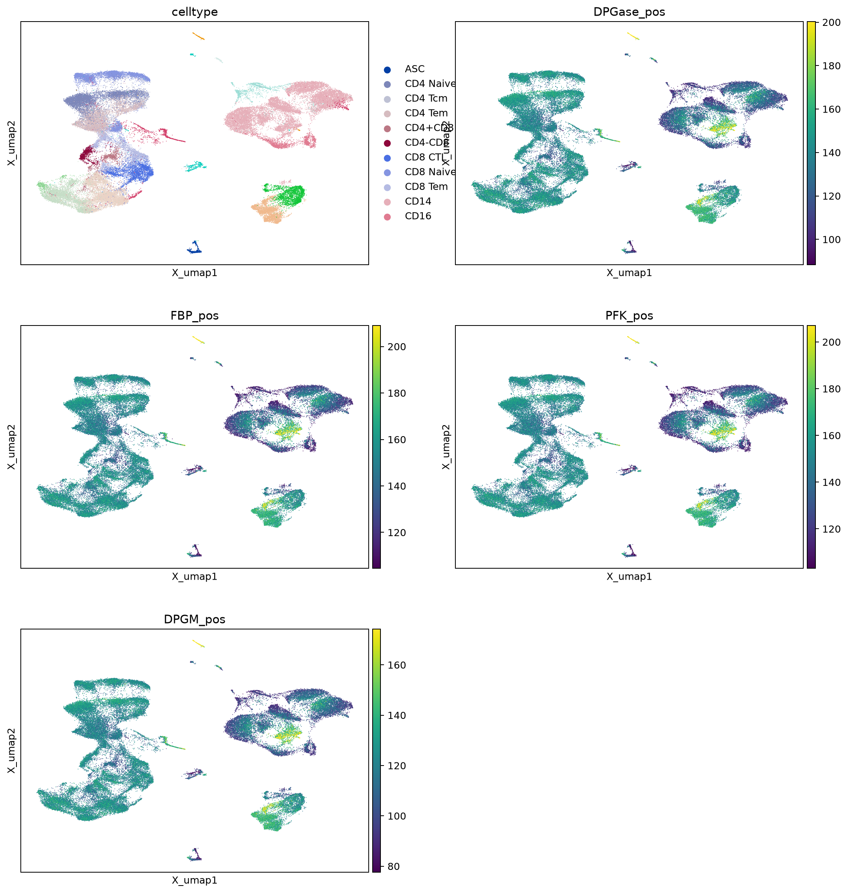
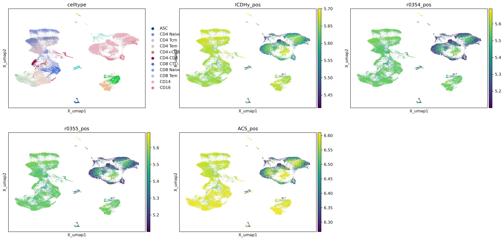
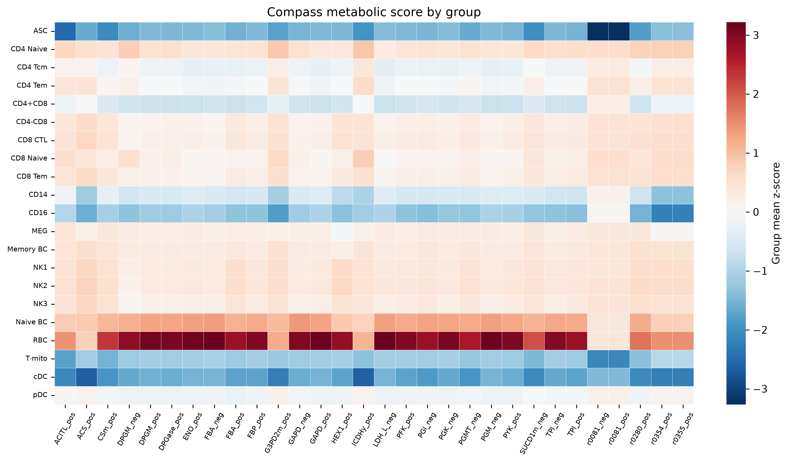
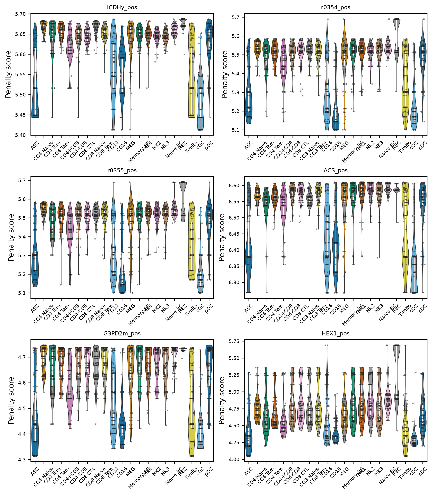
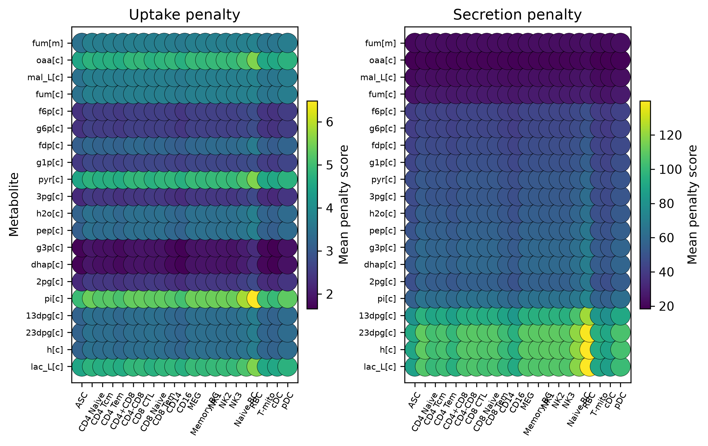
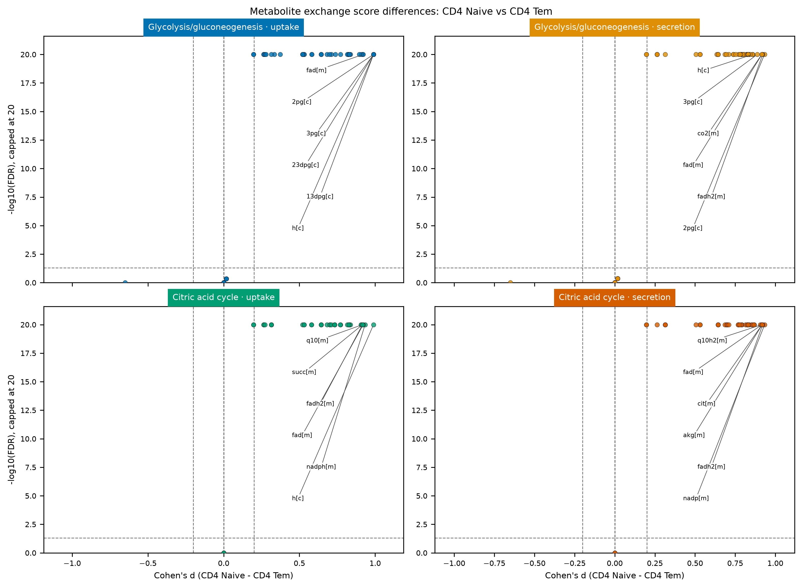
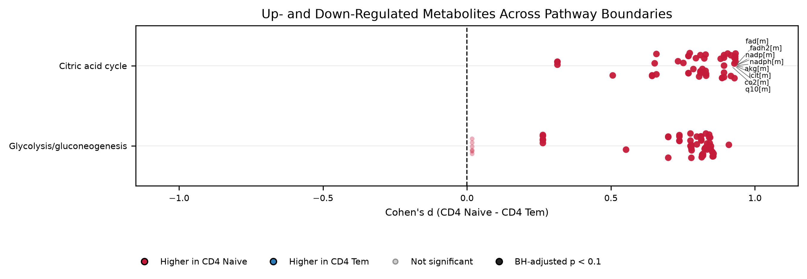
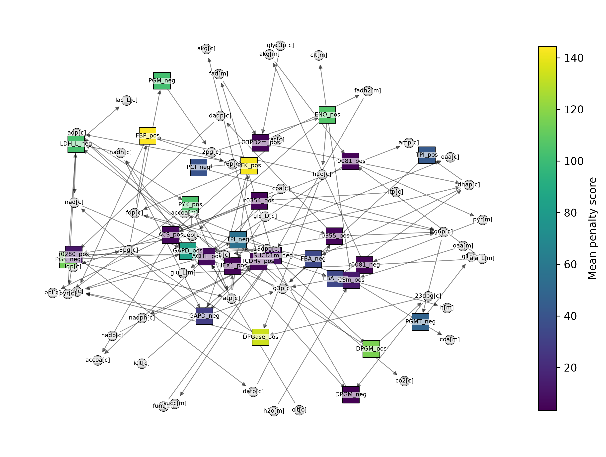

# scCompass

`scCompass` is an AnnData-native package for single-cell metabolic flux
analysis with the original Compass FBA algorithm. The Compass Python core,
metabolic models, gene resources, and Recon2 resources are bundled inside the
package; no external `compass` checkout or top-level `compass` package is
required.

The package has been designed for end-to-end work:

```text
AnnData input
  → cell/gene validation and sparse model-gene slicing
  → vectorized reaction penalties
  → optional microclustering
  → serial or process-parallel FBA
  → atomic resumable checkpoints
  → input-preserving result AnnData
  → statistical summaries, plots, and tabular export
```

Detailed API documentation is in [usage.md](usage.md).

## Main features

- AnnData-native input and output.
- Preserves the original COMPASS reaction-penalty and FBA formulas.
- Original Compass implementation and Resources bundled under `src/core`.
- Vectorized AND/OR/min/mean/median GPR reaction-expression backend.
- CPLEX backend plus optional SciPy/HiGHS backend.
- Process-parallel cell FBA.
- Atomic NPZ checkpoints with resumable execution.
- Optional cell microclustering before FBA.
- Input-preserving result AnnData:
  - original `X`, `layers`, `raw`, `var`, `varm`, `varp`, `obs`, `obsm`, and
    `obsp` are retained;
  - reaction scores are stored in `obsm["scCompass_reactions"]`;
  - uptake/secretion scores are stored in namespaced `obsm` fields.
- Group summaries, differential tests, pathway summaries, and standard
  publication-oriented figures.
- Reproducible full-data pipeline and standalone visualization scripts.

## Project layout

```text
src/                              # all scCompass package code
├── __init__.py
├── tl.py                         # analysis API
├── pl.py                         # plotting API
├── reporting.py                  # summaries, statistics, standard reports
├── adata.py                      # AnnData adapter
├── runner.py                     # Compass orchestration
├── checkpoint.py                 # resumable results
├── pipeline.py                   # full pipeline
├── highs_backend.py              # optional HiGHS backend
├── submodels.py                  # bundled metabolic submodels
└── core/                         # bundled original Compass implementation
    ├── compass/
    ├── models/
    ├── globals.py
    ├── utils.py
    └── Resources/

scripts/
├── pipeline.py                   # full-data Compass pipeline
├── pipeline_vis.py               # report generation without rerunning FBA
└── run_pbmc5k.sh                 # calculation + visualization workflow

docs/images/                      # figures included in the documentation
tests/
```

## Environment

Python 3.9 or newer is required.

```bash
python -m venv .venv
source .venv/bin/activate
python -m pip install --upgrade pip
python -m pip install -e ".[plot]"
```

For CPLEX, SBML models, and the legacy microclustering dependencies:

```bash
python -m pip install -e ".[plot,solver]"
```

CPLEX requires a valid IBM license. CPLEX Community Edition cannot solve a
full RECON2 model because it exceeds the problem-size limit. The optional
HiGHS backend does not require CPLEX:

```python
result = scCompass.compass(adata, solver_backend="highs")
```

HiGHS is currently intended for reduced models and small batches; its full
RECON2 performance has not been validated.

The cache defaults to a user-writable directory. It can be overridden:

```bash
export SCCOMPASS_CACHE_DIR=/path/to/writable/cache
```

Verify the installation:

```bash
python -c "import scCompass; print(scCompass.__version__)"
python -c "from scCompass.core import models; print(models.__file__)"
```

## Quick start

```python
import anndata as ad
import scCompass

adata = ad.read_h5ad(
    "testdata/pbmc5k_querydata.h5ad",
    backed="r",
)

result = scCompass.compass(
    adata,
    model="RECON2_mat",
    species="homo_sapiens",
    expression_layer="counts",
    lambda_=0.0,
    calc_metabolites=True,
    solver_backend="cplex",
    checkpoint_dir="outputs/pbmc_checkpoint",
    checkpoint_batch_size=64,
    num_processes=8,
    num_threads=1,
    microcluster_size=1000,
    microcluster_filter="novar",
)

result.write_h5ad("outputs/pbmc_scCompass.h5ad", compression="gzip")
```

For a short smoke test, provide `sample_size=100` and `test_mode=True`.

## Input rules

- Cells are AnnData observations.
- Genes are AnnData variables.
- `expression_layer="counts"` reads `layers["counts"]`.
- `expression_layer=None` reads `X`.
- No normalization is performed implicitly.
- COMPASS expects linear/count-scale expression and applies its original
  `log2(expression + 1)` transformation internally.
- Only genes matching the model and its aliases are sliced for the core.
- Duplicate gene symbols are aggregated with the legacy behavior.

## Result AnnData

```text
result.X                              original input expression
result.layers                         original expression layers
result.raw                            original raw AnnData
result.var / result.varm / result.varp original feature data
result.obs                            original cell annotations
result.obsm["X_pca"]                  original PCA
result.obsm["X_umap"]                 original UMAP
result.obsm["scCompass_reactions"]    cells × reactions
result.obsm["scCompass_uptake"]       cells × metabolites
result.obsm["scCompass_secretion"]    cells × metabolites
result.uns["scCompass_reaction_var"]  reaction metadata
result.uns["scCompass"]               parameters, model, checkpoint provenance
```

The primary `X` remains the input expression matrix. Reaction scores are not
stored in `X`.

Use:

```python
reactions = scCompass.to_dataframe(result, key="reactions")
uptake = scCompass.to_dataframe(result, key="uptake")

scores_only = scCompass.result.to_score_anndata(result)
```

## Full PBMC workflow

Run calculation and visualization:

```bash
bash scripts/run_pbmc5k.sh
```

Defaults:

- Full `testdata/pbmc5k_querydata.h5ad`
- All 58,677 cells
- Central-carbon RECON2-compatible submodel
- 8 workers
- 1 CPLEX thread per worker
- microcluster target size 1000
- resumable checkpoint

The current full-data result uses the central-carbon model because the local
CPLEX Community Edition cannot solve full RECON2. Use `MODEL_SCOPE=full` with a
full CPLEX license for all RECON2 reactions.

Generate figures from an existing result without rerunning FBA:

```bash
python scripts/pipeline_vis.py \
  --input outputs/pbmc5k_full_pipeline/result.h5ad \
  --output-dir outputs/pbmc5k_visual_report \
  --groupby celltype \
  --top-n 20
```

## Example figures

### Pipeline embedding



### Reaction UMAP



### Group-level reaction heatmap



### Selected reaction distributions



### Metabolite uptake and secretion profiles



### Metabolite group-difference volcano panels



### Metabolite pathway boundary strip plot



### Local reaction–metabolite network



## Analysis and plotting API

```python
summary = scCompass.tl.group_summary(result, groupby="celltype")
difference = scCompass.tl.differential(result, groupby="celltype")
pathways = scCompass.tl.pathway_summary(result, groupby="celltype")

scCompass.pl.umap(result, color=["PFK_pos", "celltype"])
scCompass.pl.heatmap(result, groupby="celltype", top_n=30)
scCompass.pl.raincloud(
    result,
    groupby="celltype",
    features=["DPGase_pos", "PFK_pos", "FBP_pos"],
)
scCompass.pl.metabolite_dotplot(result, groupby="celltype")
scCompass.pl.metabolite_volcano(
    result,
    groupby="celltype",
    group_a="CD4 Naive",
    group_b="CD4 Tem",
)
scCompass.pl.metabolite_pathway_strip(
    result,
    groupby="celltype",
    group_a="CD4 Naive",
    group_b="CD4 Tem",
)
scCompass.pl.network(result, groupby="celltype", top_n=20)
```

`metabolite_pathway_strip()` aggregates all non-exchange reactions incident to
each metabolite within a pathway into a per-cell metabolite-pathway score.
Each point is a metabolite: x is Cohen's d, red/blue indicates the group with
higher penalty, and opacity/size distinguishes FDR-significant changes.

See [usage.md](usage.md) for all parameters, output schemas, and examples.

## Interpreting scores

Compass reaction and exchange values are minimum penalty scores.

- Lower scores generally indicate more favorable expression-consistent flux.
- An exact zero may also represent a blocked reaction in the original
  algorithm.
- Do not describe scores as measured fluxes.
- Compare reactions using reaction-specific distributions or normalized
  group summaries.
- If multiple donors are present, use donor-level pseudobulk or mixed models
  for group inference rather than treating every cell as independent.

## Tests

```bash
MPLBACKEND=Agg .venv/bin/python -m pytest -q
```

The suite covers the AnnData adapter, original model loading, vectorized
penalties, result preservation, checkpoint resume, parallel workers, CPLEX and
HiGHS backends, PBMC integration, the full pipeline, and all plotting APIs.
